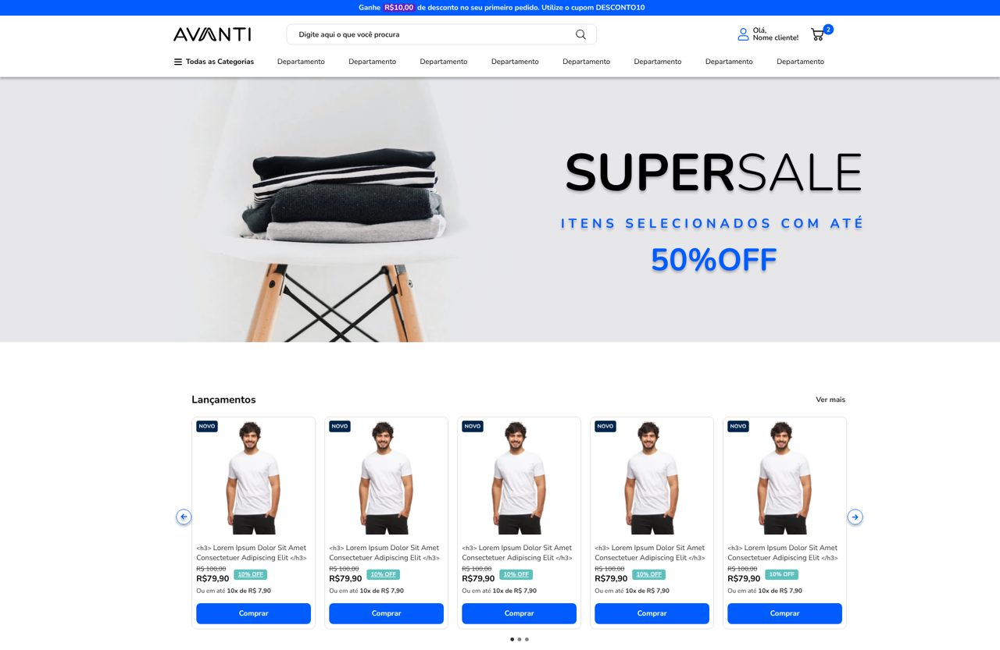

# Avanti Innovation Class 19 — Desafio 01: Layout

Landing page desenvolvida a partir do layout do Figma, com versões **desktop** e **mobile**.



## Tecnologias

- HTML5 semântico
- CSS3 puro (Flexbox, Grid, variáveis CSS, media queries)
- JavaScript (sem frameworks)
- [Swiper 11](https://swiperjs.com/) para os carrosséis
- Google Fonts: Nunito, Nunito Sans e Heebo

## Funcionalidades

- **Busca:** ao clicar na lupa (ou apertar Enter), aparece abaixo do campo a mensagem
  `Você buscou por: 'termo buscado'`.
- **Carrosséis de produtos:** setas, 3 indicadores clicáveis e arraste no touch.
  Mostra 5 produtos no desktop, 4 em telas médias e 2 no mobile.
- **Mega menus:** ao passar o mouse em "Todas as Categorias" ou em um "Departamento".
- **Responsivo:** layout desktop (Figma de 1920px) a partir de 1024px e layout mobile
  (Figma de 390px) abaixo disso.
- **Fidelidade:** cores, textos, imagens e medidas seguindo o Figma.

## Como rodar

Não precisa instalar nada: basta abrir o `index.html` no navegador.

Se quiser um servidor local (opcional):

```bash
npx serve .
```

## Estrutura

```
├── index.html
├── css/
│   └── style.css      # estilos organizados por seção + bloco mobile no final
├── js/
│   └── main.js        # busca, mega menus, cards de produto e carrosséis
└── assets/
    ├── icons/         # SVGs exportados do Figma
    └── img/           # imagens exportadas do Figma (WebP)
```

## Decisões técnicas

- **Cards gerados por JavaScript:** os 15 produtos vêm de um array em `main.js` e são renderizados
  nos dois carrosséis, o que evita repetir o mesmo HTML 30 vezes.
- **`textContent` na busca:** o texto digitado nunca é interpretado como HTML.
- **`mix-blend-mode: darken` no banner principal:** no Figma, a imagem usa o modo de mesclagem
  "Darken", por isso o fundo branco da foto se mistura ao cinza.
- **Ícones com `mask` + `currentColor`:** as setinhas do mega menu mudam de cor junto com o texto.
